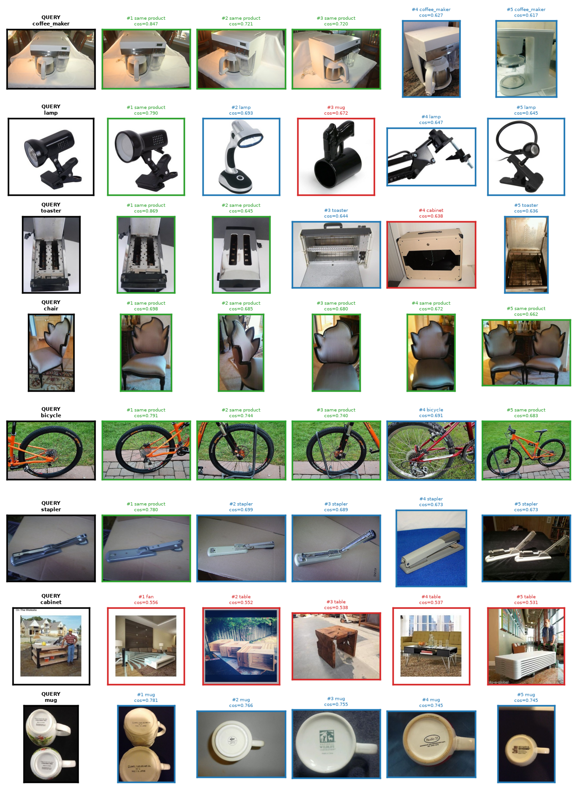

# 🛍️ Visual Product Similarity & Image-Based Recommendation System
### Amazon-style "Similar items" and search-by-image over 58,891 real eBay product photos

Upload a product photo and get the most **visually similar** products in the catalog in
milliseconds, with no text, titles or tags involved. Every product page also gets a
*"Customers who viewed this item also viewed"* strip that is driven purely by image
similarity.

**Domain:** E-commerce
**Dataset:** Stanford Online Products (eBay listings): 12 categories, 11,311 products, 58,891 photos
**Stack:** Python · PyTorch / torchvision (ResNet50, EfficientNet-B0) · FAISS · SQLite · Streamlit · pandas · matplotlib

| Headline result (ResNet50 + GeM, HNSW) | |
|---|---|
| Product Recall@1: another photo of the *same listing* is the #1 match | **0.602** (random: 0.00007) |
| Product Recall@10 | **0.761** |
| Category Precision@1 / @10 | **0.917** / **0.799** (random: 0.088) |
| HNSW vs exact search: top-10 agreement | **99.98 %** |
| Search latency per query (58,891 vectors) | **~1 ms** (brute force ~16 ms) |
| Shopper-style distorted photo → correct product at #1 | **99 %** |

📊 **Presentation:** [`docs/presentation.pptx`](docs/presentation.pptx) - 19 slides with speaker notes.

---

## Table of Contents

1. [Problem & Objectives](#1-problem--objectives)
2. [Quick Start](#2-quick-start)
3. [Architecture](#3-architecture)
4. [Dataset & Cleaning](#4-dataset--cleaning)
5. [Feature Extraction](#5-feature-extraction)
6. [FAISS Indexing](#6-faiss-indexing)
7. [Search, Ranking & Filtering](#7-search-ranking--filtering)
8. [Database Design](#8-database-design)
9. [Evaluation & Results](#9-evaluation--results)
10. [Streamlit App Walkthrough](#10-streamlit-app-walkthrough)
11. [Notebooks](#11-notebooks)
12. [Tests](#12-tests)
13. [Limitations & Future Work](#13-limitations--future-work)
14. [Project Structure](#14-project-structure)

---

## 1. Problem & Objectives

Marketplace metadata (titles, descriptions, tags) is often noisy, incomplete or misleading.
Keyword search fails when a shopper wants *"something that looks like this"*: the same
style, colour or design. This project builds the computer-vision alternative:

- Extract **high-quality visual embeddings** from product images with a pretrained CNN
- Build a **fast similarity search engine** with FAISS approximate nearest neighbour search
- Return and rank the **Top-K visually similar products** for any input image
- Support business **filters** (category, price range, availability)
- Measure quality with **Precision@K, Recall@K** and visual inspection
- Serve it through an interactive **Streamlit** app

---

## 2. Quick Start

### Prerequisites
- Python 3.11+
- ~10 GB free disk space (3 GB dataset zip, 3 GB extracted, ~1 GB processed images, ~2 GB indexes)
- Optional: NVIDIA GPU. Everything also runs on CPU; embedding 59k photos just takes longer.

### Setup

```bash
# 1. Install dependencies
pip install -r requirements.txt
#    (GPU build of PyTorch, optional)
pip install torch torchvision --index-url https://download.pytorch.org/whl/cu126

# 2. Download + extract Stanford Online Products (~3 GB) -> data/raw/Stanford_Online_Products/
python scripts/download_dataset.py

# 3. Run the whole pipeline: clean -> SQLite -> embeddings -> FAISS -> evaluation
python -m src.pipeline

# 4. Launch the app
streamlit run app/streamlit_app.py
```

The app opens at <http://localhost:8501>. On an RTX 3060 laptop GPU the full pipeline takes
**about 8 minutes**: cleaning + DB load ~1.5 min, embeddings ~3 min (ResNet50) and ~1.5 min
(EfficientNet-B0), HNSW builds ~20-30 s each, and evaluation of both models ~2 min.

### Running stages individually

```bash
python -m src.data_cleaning                         # validate, resize, dedupe -> processed CSVs
python -m src.database                              # load catalog into SQLite
python -m src.feature_extractor --model resnet50    # embeddings -> models/*.npy
python -m src.indexer --model resnet50              # FAISS indexes -> models/*.index
python -m src.evaluation                            # metrics + figures -> reports/
```

### Configuration

All paths and parameters live in [`config.py`](config.py). Some can be overridden with
environment variables:

| Variable | Default | Purpose |
|---|---|---|
| `SOP_SPLIT` | `test` | `test` (60,502 images, standard benchmark), `train`, or `all` |
| `MAX_PRODUCTS_PER_CATEGORY` | *(all)* | e.g. `200` for a quick ~10k-image run |
| `EMBEDDING_MODEL` | `resnet50` | Default backbone (`resnet50` / `efficientnet_b0`) |
| `INDEX_TYPE` | `hnsw` | Default FAISS index (`hnsw` / `flat`) |
| `NUM_WORKERS` | `4` | Data-loader processes for embedding |
| `SOP_ROOT`, `DB_PATH` | under `data/` | Dataset / database locations |

---

## 3. Architecture

```
                              OFFLINE  (python -m src.pipeline)
 ┌─────────────────────┐   ┌──────────────────────┐   ┌──────────────────────┐   ┌─────────────────┐
 │ Stanford Online     │──>│ data_cleaning        │──>│ feature_extractor    │──>│ indexer (FAISS) │
 │ Products, test split│   │ validate, RGB, 320px,│   │ ResNet50 (GeM) /     │   │ Flat + HNSW     │
 │ 60,502 photos       │   │ dHash + colour dedupe│   │ EfficientNet-B0, no  │   │ inner product   │
 └─────────────────────┘   └──────────┬───────────┘   │ classifier, L2-norm  │   │ = cosine        │
                                      v               └──────────┬───────────┘   └────────┬────────┘
                    ┌────────────────────────────────────────────┴─────────┐             │
                    │ SQLite: categories → products → product_images       │<────────────┘
                    │         image_embeddings (FAISS row → photo)         │  row mapping
                    │         embedding_models, search_logs                │
                    └──────────────────────────┬───────────────────────────┘
                                               │      ONLINE  (Streamlit → search_engine)
 query photo ─> CNN embedding ─> FAISS top photos (filters inside) ─> group by product ─> ranked products
```

---

## 4. Dataset & Cleaning

**Source:** [Stanford Online Products](https://cvgl.stanford.edu/projects/lifted_struct/)
(Song et al., *Deep Metric Learning via Lifted Structured Feature Embedding*, CVPR 2016),
also listed in [TensorFlow Datasets](https://www.tensorflow.org/datasets/catalog/stanford_online_products).
It contains product photos from **eBay listings** with two levels of ground truth:

- **category**: 12 classes (bicycle, cabinet, chair, coffee maker, fan, kettle, lamp, mug,
  sofa, stapler, table, toaster)
- **product**: the individual listing, photographed 2-12 times (median 4.5)

I use the **official test split** (60,502 images, 11,316 products), which is the standard
retrieval benchmark and 60× the brief's 1,000-image minimum. No model is trained, so the
train split isn't needed.

`src/data_cleaning.py` processes every image in parallel worker processes:

| Check | Why | Removed |
|---|---|---|
| File fully decodes | corrupt / truncated downloads | 0 |
| Min side ≥ 64 px | thin slivers (e.g. 400×63) | 3 |
| Pixel std-dev ≥ 2 | blank images | 1 |
| Convert to RGB, resize to ≤ 320 px | ~0.5 % are greyscale; 224 px is all the CNN needs | (applied to all) |
| **Duplicate photos** within a listing | same photo uploaded twice | **1,536** |
| **Duplicate photos** across listings | same stock photo used by different sellers | **71** |

**Clean catalog: 58,891 photos of 11,311 products** (2.7 % removed).

**Scalable duplicate detection.** Comparing every pair of 60k images is 1.8 billion
comparisons. Each image gets a 64-bit difference hash (dHash). Then the pigeonhole
principle applies: if two hashes differ in ≤ 4 bits, at least one of 5 hash chunks is
identical, so only images that share a chunk are compared.

**Lesson learned: a hash is not enough.** In my first version, visual review showed that
the greyscale dHash merged **colour variants** (a red and a blue version of the same sofa)
and **unrelated dark photos** whose coarse gradients collide by chance. Checking the
*average* colour difference didn't help either, because a colour variant only changes part
of the frame. The final rule confirms a candidate pair only if **no pixel** of the 16×16 RGB
thumbnails differs by more than 48 levels. A hash-only rule would have wrongly deleted
**1,205** legitimate photos.

**Why duplicates matter for evaluation:** in leave-one-out testing, an identical copy of the
query would be "found" at rank 1 for free. Cross-listing copies are worse: identical
images labelled as *different* products.

**Metadata:** SOP provides images and labels only, but the brief asks for optional filtering
by price and availability. So price (category-specific, log-uniform ranges), rating and
in-stock flags are **simulated per product with a fixed seed**. This is flagged in the app.

---

## 5. Feature Extraction

`src/feature_extractor.py`

| Backbone | Weights | Head removed | Pooling | Embedding |
|---|---|---|---|---|
| **ResNet50** | ImageNet-1K V2 | `fc` → `Identity` | **GeM (p = 3)** | 2048-d |
| EfficientNet-B0 | ImageNet-1K V1 | `classifier` → `Identity` | global average | 1280-d |

- **L2-normalisation**: with unit vectors, *inner product = cosine similarity*.
- **Resize the whole photo to 224×224** instead of center-cropping, so the product isn't cut off.
- **Horizontal-flip test-time augmentation**: average of the photo and its mirror image.
- **Mixed precision (fp16) + 4 data-loader workers** for bulk extraction (~400 img/s for
  ResNet50 on an RTX 3060 laptop GPU). Single-image app queries run in **fp32**: the fp16
  path costs ~3 s on its first call in every new thread, and Streamlit serves each rerun
  from a fresh thread. Found while profiling the app; vectors from both paths have cosine
  similarity 1.0000.

**Ablation** (notebook 02; 1,000 products / 5,197 photos; mean change in product Recall@1):

| Change | ResNet50 | EfficientNet-B0 |
|---|---|---|
| Resize vs center-crop | **+0.046** | **+0.036** |
| GeM vs average pooling | **+0.040** | −0.014 |
| Flip-TTA on vs off | +0.007 | +0.001 |

GeM pooling helps ResNet50 but not EfficientNet-B0, so pooling is set per backbone
(`config.MODEL_POOLING`). On the full catalog, this one change raised ResNet50's product
Recall@1 from **0.559 → 0.602** and moved it ahead of EfficientNet-B0.

---

## 6. FAISS Indexing

`src/indexer.py` builds two indexes per backbone:

| Index | Kind | Role |
|---|---|---|
| `IndexFlatIP` | exact brute force | ground truth for ANN fidelity |
| `IndexHNSWFlat` (M=32, efConstruction=200, efSearch=128) | approximate graph | **served by the app** |

Speed/accuracy trade-off on the **real** 58,891 × 2048-d ResNet50 vectors (notebook 02,
2,000 queries):

| Index | ms / query | Recall@10 vs exact |
|---|---|---|
| HNSW efSearch=16 | 0.43 | 98.68 % |
| HNSW efSearch=64 | 0.99 | 99.85 % |
| **HNSW efSearch=128** | **1.58** | **99.96 %** |
| HNSW efSearch=512 | 5.54 | 100.00 % |
| Flat (exact) | 37.5 | 100 % |

(Absolute timings vary between runs on a laptop; the evaluation run measured ~0.9 ms HNSW
vs ~16 ms flat.) Brute-force cost grows linearly with the catalog and HNSW roughly
logarithmically, so the gap widens at marketplace scale.

---

## 7. Search, Ranking & Filtering

`src/search_engine.py` → `VisualSearchEngine`

FAISS stores one vector per **photo**, but shoppers want **products**. The engine fetches
8× more photo hits than K, groups them by product, keeps each product's best-matching photo,
and fetches more if it still has fewer than K distinct products.

- `search_image(image, top_k, filters)`: upload / camera / any image
- `similar_to_product(product_id, top_k, filters)`: "Similar items". The query is the
  **mean embedding of all the product's photos** (a multi-view product vector), and the
  product itself is excluded.

**Ranking:** cosine similarity of each product's best photo, with ties broken by rating. The
app can re-sort the retrieved set by price or rating.

**Filtering:** category / price range / in-stock filters are pushed **into** the FAISS
search with an `IDSelectorBatch`, so K results still come back when a filter is selective.
If the HNSW graph can't fill K results under a very selective filter, the engine falls back
to exact scoring of the eligible subset.

---

## 8. Database Design

SQLite (`data/products.db`), normalised (3NF), with foreign keys, CHECK constraints and indexes:

```
categories        (category_id PK, category_name UNIQUE)
     │ 1:N
products          (product_id PK = eBay item id, sop_class_id UNIQUE, category_id FK,
                   product_name, price CHECK>=0, rating CHECK 0-5, in_stock CHECK 0/1)
     │ 1:N
product_images    (image_id PK, product_id FK, view_index, image_file UNIQUE,
                   width, height, orig_width, orig_height, image_hash)
     │ 1:N
image_embeddings  (model_id FK, vector_row, image_id FK)    PK(model_id, vector_row)
     │ N:1
embedding_models  (model_id PK, model_name UNIQUE, embedding_dim, num_vectors, created_at)

search_logs       (search_id PK, query_type, model_name, top_k, num_results,
                   latency_ms, category_filter, created_at)
```

- **`image_embeddings`** links FAISS, which only stores vectors, to the catalog:
  FAISS row *i* → photo → product.
- Indexes: `products(category_id)`, `products(price)`, `products(in_stock)`,
  `product_images(product_id, view_index)`, `image_embeddings(image_id)`,
  `search_logs(created_at)`. `EXPLAIN QUERY PLAN` in notebook 01 confirms the catalog filter
  query uses them; a filtered catalog page loads in ~4 ms.
- All queries are parameterised, and every connection runs in a transaction that rolls back
  on error.

---

## 9. Evaluation & Results

**Protocol: leave-one-out over the whole catalog.** Each of the 58,891 photos queries all
the others (HNSW, top-20). There are two levels of relevance:

| Level | Relevant result | Metrics |
|---|---|---|
| **Product** | another photo of the *same listing* | Precision@K, Recall@K, mAP@K |
| **Category** | a photo from the same category | Precision@K |

For the product level, **Recall@K** is the hit rate (at least one photo of the same product
in the top-K). This is how the SOP / metric-learning literature defines Recall@K. The classic
definition (fraction of the product's photos found) is reported in the notebook too.

### Overall

| Model | Product R@1 | R@5 | R@10 | R@20 | Product mAP@10 | Category P@1 | P@10 |
|---|---|---|---|---|---|---|---|
| **ResNet50 (GeM)** | **0.602** | **0.722** | **0.761** | **0.797** | **0.316** | **0.917** | **0.799** |
| EfficientNet-B0 | 0.568 | 0.687 | 0.728 | 0.766 | 0.288 | 0.905 | 0.791 |
| *ResNet50 (avg pool, before ablation)* | *0.559* | *0.677* | *0.720* | | *0.279* | *0.904* | *0.791* |
| *Random* | *0.00007* | | | | | *0.088* | *0.088* |

### Per category (ResNet50)

| | lamp | table | stapler | chair | mug | cabinet | toaster | sofa | fan | kettle | coffee maker | bicycle |
|---|---|---|---|---|---|---|---|---|---|---|---|---|
| **Product R@1** | 0.69 | 0.68 | 0.66 | 0.65 | 0.64 | 0.62 | 0.59 | 0.58 | 0.56 | 0.55 | 0.47 | 0.43 |
| **Category P@10** | 0.77 | 0.64 | 0.85 | 0.72 | 0.91 | 0.82 | 0.74 | 0.79 | 0.77 | 0.84 | 0.80 | 0.96 |

- **Bicycle** has the *highest* category precision (bikes only look like bikes) but the
  *lowest* product recall: one bike is hard to tell from another, and bicycle listings
  include the most detail shots.
- **Coffee makers and kettles** have the same problem: many near-identical stainless-steel
  and black-plastic products.
- Category confusions make sense: sofa → chair (6 %), table ↔ cabinet, coffee maker ↔ kettle.
- Recall@1 rises with the number of photos per listing (0.42 with one other photo → ~0.68
  with 8+). The query's view index barely matters (0.62 → 0.58).

### Speed, ANN fidelity, robustness (ResNet50)

| Check | Result |
|---|---|
| HNSW top-10 vs exact top-10 | **99.98 %** overlap |
| FAISS HNSW search | **~0.9 ms** per query (p95 ~1.4 ms); flat ~16 ms |
| CNN embedding (single image, GPU, fp32 + flip-TTA) | ~14 ms median |
| Group-by-product + ranking + metadata | ~4-5 ms |
| Shopper-style photo (random crop + rotation + colour shift) → correct product #1 | **99 %** of 300 trials |

### Visual inspection



Green = another photo of the same product, blue = same category, red = different category.
Other photos of the same listing, taken from different angles, are retrieved first. Misses
are mostly look-alike products from other sellers, detail close-ups, or seller photos where
the scene dominates (the cabinet row).

---

## 10. Streamlit App Walkthrough

```bash
streamlit run app/streamlit_app.py
```

**Sidebar (all pages):** embedding model (defaults to the best model in
`reports/metrics.json`), FAISS index (HNSW / Flat), Top-K slider, and filters: category
multiselect, price range slider, in-stock toggle.

| Page | What it does |
|---|---|
| **Image search** | Upload a photo, use the camera, or pick a random catalog photo per category. Returns the Top-K products, each with its best-matching photo, a similarity bar, CNN and search timings, and a category breakdown. Results can be sorted by similarity, price or rating, and *Find similar* jumps to a product's similar-items view. |
| **Similar items** | Paginated catalog of 11,311 products, 24 per page, filtered in SQL. *Find similar* opens a product with its full photo gallery and a *"Customers who viewed this item also viewed"* strip. Clicking a result continues browsing. |
| **Evaluation** | Product and category metrics by K, model comparison, per-category table and chart, visual inspection grid, and upload-robustness metrics. |
| **How it works** | Pipeline summary, cleaning statistics, and search usage from the `search_logs` table. |

Performance: the CNN and FAISS index load once per server (`st.cache_resource`), the
embedding matrix is memory-mapped, and catalog pages use `LIMIT/OFFSET` instead of loading
all products.

---

## 11. Notebooks

| Notebook | Contents |
|---|---|
| [`01_data_exploration_cleaning.ipynb`](notebooks/01_data_exploration_cleaning.ipynb) | Split statistics, photos per product, resolutions, multi-view examples, duplicate analysis (within / across listings), the colour-check lesson, simulated metadata, SQLite load and query plans |
| [`02_feature_extraction_indexing.ipynb`](notebooks/02_feature_extraction_indexing.ipynb) | Removing the classifier head, extracting 58,891 embeddings per model, t-SNE, same-product vs same-category similarity, preprocessing / pooling / flip ablation for both backbones, FAISS build, HNSW efSearch sweep vs exact search |
| [`03_search_evaluation.ipynb`](notebooks/03_search_evaluation.ipynb) | Similar-items and image-search demos, filters, full evaluation of both models, per-category and confusion analysis, visual inspection, failure analysis, ANN fidelity, latency, upload robustness |

Run them in order: 01 rebuilds the catalog, 02 re-creates embeddings and indexes, and 03
evaluates. They import from `src/`, so the notebooks and the app share one code path.

---

## 12. Tests

```bash
pytest -q
```

15 tests covering:
- metric maths (P@K, R@K, Hit@K, AP@K; vectorised == scalar)
- SOP index parsing and product sampling
- dHash duplicates, including **keeping colour variants**
- GeM pooling behaviour
- FAISS Flat/HNSW correctness
- SQLite filters, pagination, product photos, FK enforcement and search logging

They don't need the dataset or a GPU.

---

## 13. Limitations & Future Work

- **Generic ImageNet features.** Most remaining misses are look-alike products and detail
  close-ups. Fine-tuning on the SOP *train* split with a metric-learning loss (e.g. triplet,
  multi-similarity or proxy-anchor) teaches product-level identity. The literature reports
  large gains on this exact benchmark.
- **No sense of scale.** A curved black gaming chair can match staplers. Combining the visual
  score with the category from a lightweight classifier, or using the category filter, fixes
  most of these cases.
- **Scene-dominated photos.** An object-detection crop before embedding (e.g. YOLO) would
  focus the vector on the product.
- **Simulated metadata.** Price, rating and stock are synthetic. With real catalog data, the
  schema and filters stay the same.
- **Index size.** Float32 2048-d vectors take ~500 MB for 59k photos. For millions of
  products, use FAISS IVF-PQ compression or reduce dimensionality.

---

## 14. Project Structure

```
Project_4/
├── README.md
├── requirements.txt
├── config.py                      # all paths & parameters
├── src/
│   ├── data_cleaning.py           # SOP loading, validation, resize, scalable dedupe, metadata
│   ├── database.py                # SQLite schema, loading, filtered pagination, logs
│   ├── feature_extractor.py       # ResNet50 (GeM) / EfficientNet-B0 embeddings
│   ├── indexer.py                 # FAISS Flat + HNSW build / save / load
│   ├── search_engine.py           # VisualSearchEngine: search, group-by-product, filters
│   ├── evaluation.py              # product & category P@K / R@K, ANN fidelity, latency
│   └── pipeline.py                # end-to-end runner
├── app/
│   ├── streamlit_app.py           # entry point + navigation
│   ├── common.py                  # cached engine, sidebar, product cards
│   └── app_pages/
│       ├── image_search.py
│       ├── similar_items.py
│       ├── evaluation.py
│       └── about.py
├── notebooks/
│   ├── 01_data_exploration_cleaning.ipynb
│   ├── 02_feature_extraction_indexing.ipynb
│   └── 03_search_evaluation.ipynb
├── docs/
│   └── presentation.pptx          # project presentation (19 slides, speaker notes)
├── scripts/
│   └── download_dataset.py        # resumable download + extract of SOP
├── tests/
│   └── test_core.py
├── data/                          # raw SOP, processed images + CSVs, products.db (git-ignored)
├── models/                        # embeddings (.npy) and FAISS indexes (git-ignored)
└── reports/                       # metrics.json, per-query metrics, figures
```

**Citation:** Hyun Oh Song, Yu Xiang, Stefanie Jegelka, Silvio Savarese. *Deep Metric
Learning via Lifted Structured Feature Embedding.* CVPR 2016.
